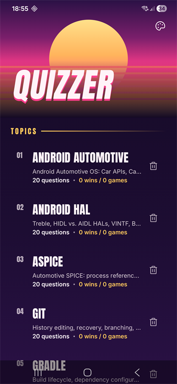
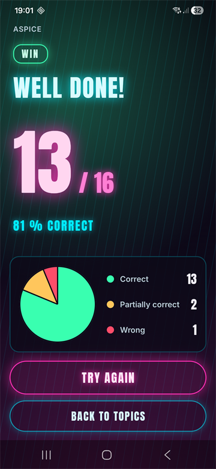
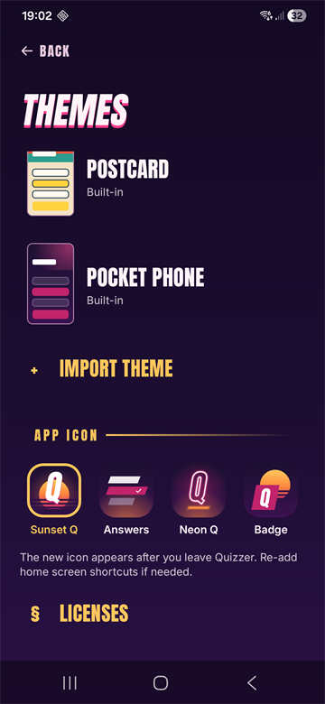

# Quizzer
How can I easily learn new things while commuting?

Quizzer is a simple Android quiz app (Kotlin + Jetpack Compose). Questions are not hardcoded:
each topic is a JSON file that can be imported into the app. Games of 16 questions, multiple
correct answers per question, a learning history that brings back what you got wrong, and
four selectable themes.

<table>
  <tr>
    <td align="center"></td>
    <td align="center"></td>
    <td align="center"></td>
  </tr>
  <tr>
    <td align="center"><sub>Topics · Sunset Coast</sub></td>
    <td align="center"><sub>Quiz · Neon Night</sub></td>
    <td align="center"><sub>Result · Neon Night</sub></td>
  </tr>
  <tr>
    <td align="center"></td>
    <td align="center"></td>
    <td align="center"></td>
  </tr>
  <tr>
    <td align="center"><sub>Quiz · Postcard</sub></td>
    <td align="center"><sub>Topics · Pocket Phone</sub></td>
    <td align="center"><sub>Themes & app icon</sub></td>
  </tr>
</table>

## Topics

Nine topics with 20 questions each are built in, aimed at Android Automotive HMI developers:

| Topic | Covers |
|---|---|
| ASPICE | Capability levels, ratings, VDA scope, SWE/SUP processes, changes in 4.0 |
| SAFe | ARTs, PI Planning, WSJF, roles, events, enablers (SAFe 6.0) |
| Android Automotive | Car APIs, CarService, UX restrictions, users, audio, power, system UI |
| Soong Build System | Android.bp, module types, lunch/m, Kati and Ninja |
| Gradle | Build phases, configurations, caching, version catalogs, Android variants |
| Git | History editing, recovery, internals, repo/Gerrit workflow |
| Kotlin | Language features, generics, coroutines and Flow |
| VHAL | Property IDs, change modes, areas, AIDL interface, debugging |
| Android HAL | Treble, HIDL vs. AIDL, VINTF, versioning, Binder |

- **Import topic** (end of the topic list) adds your own topic files, see [Writing topics](#writing-topics).
- Topics can be deleted; this also deletes their statistics. Built-in topics you delete don't come back,
  but new built-in topics from app updates appear automatically.
- The topic list shows wins / games per topic.

## Game rules

- A game has 16 questions, picked at random; questions answered wrong before come up more often.
  Topics with fewer questions give a short game with all of them.
- **Correct:** exactly the correct answers selected. **Partially correct:** at least one correct
  answer selected, but not exactly the right set. **Wrong:** no correct answer selected.
- You win with at least 75 % correct (rounded up: 12 of 16). Partially correct doesn't count.
- Answers are shuffled for every question, and the buttons show random labels in many languages
  ("Fire!", "¡Vamos!", "行くぞ!", …).

## Themes and app icon

Tap the palette icon on the topic list:

- **Themes:** Sunset Coast (default), Neon Night, Postcard and Pocket Phone are built in. A theme
  changes colors, fonts, shapes and backgrounds; the layout stays the same. More themes can be
  imported as theme JSON files (schema v1, documented in
  [`docs/design/themes/sunset-coast/handoff.md`](docs/design/themes/sunset-coast/handoff.md)).
- **App icon:** Sunset Q (default), Answers, Neon Q or Badge. The new icon appears after you leave
  the app; on some launchers, home screen shortcuts need to be re-added.
- **Licenses:** the licenses of Quizzer and the components it uses.

## Writing topics

One JSON file per topic. Each question has 2–4 answers; one, several, or all of them can be correct.

```json
{
  "title": "ASPICE",
  "description": "Optional short description shown in the topic list.",
  "questions": [
    {
      "question": "Which of these are capability levels in ASPICE?",
      "answers": [
        { "text": "Level 0 – Incomplete", "correct": true },
        { "text": "Level 1 – Performed",  "correct": true },
        { "text": "Level 7 – Perfect",    "correct": false }
      ],
      "explanation": "Optional. Shown after the answer has been checked."
    }
  ]
}
```

| Field | Required | Notes |
|---|---|---|
| `title` | yes | Importing a file with the same title replaces the existing topic. |
| `description` | no | |
| `questions[].question` | yes | |
| `questions[].answers` | yes | 2–4 entries, at least one with `"correct": true`. |
| `answers[].correct` | no | Defaults to `false`. |
| `questions[].explanation` | no | |

Give a topic at least 16 questions for full games. The app validates files on import and names
the problem if one is invalid.

**Only add new questions at the end of a file.** The learning history is stored per question
position (question IDs like `aak-0`, `aak-1`, generated from the title's initials, e.g.
"Android Automotive Knowledge" → `aak`), so inserting, deleting or reordering questions mixes up
the history. Fixing a question's wording is fine.

## Build and run

Requirements:

- Android 8.0 (API 26) or newer on the device; built for Android 16 (API 36).
- JDK 17 or newer to start Gradle. The build itself runs on JDK 21, which Gradle finds or downloads
  automatically.
- Android SDK with platform 36, e.g. via Android Studio.

**Android Studio:** open the project folder, wait for the Gradle sync, select your device and click
**Run**.

**Command line:**

```
.\gradlew installDebug        # build and install on the connected device
.\gradlew testDebugUnitTest   # run unit tests
```

## Project structure

| Path | Content |
|---|---|
| `app/src/main/assets/topics/` | Built-in topics |
| `app/src/main/assets/themes/` | Built-in themes |
| `app/src/main/assets/licenses/` | License texts shown in the app |
| `app/src/main/res/values/labels.xml` | Random button labels |
| `app/src/main/java/com/quizzer/app/` | `data/` topics and statistics, `quiz/` game logic, `theme/` theme engine, `ui/` screens, `appicon/` icon switching |
| `docs/PLAN.md` | Plan, decisions and open items |
| `docs/design/` | Design handoffs for themes and app icons |

## License

Quizzer is licensed under the [GNU General Public License v3.0](LICENSE).

### Third-party licenses

The following files are **not** covered by the GPL; they keep their own licenses. The full texts
are in [`app/src/main/assets/licenses/`](app/src/main/assets/licenses/) and are shown in the app
(palette icon → Licenses).

| Component | Files | License |
|---|---|---|
| Anton (The Anton Project Authors) | `app/src/main/res/font/anton_regular.ttf` | SIL Open Font License 1.1 |
| Inter (The Inter Project Authors) | `app/src/main/res/font/inter_variable.ttf` | SIL Open Font License 1.1 |
| Oswald (The Oswald Project Authors) | `app/src/main/res/font/oswald_variable.ttf` | SIL Open Font License 1.1 |
| Shrikhand (Jonny Pinhorn) | `app/src/main/res/font/shrikhand_regular.ttf` | SIL Open Font License 1.1 |
| Phosphor Icons | `app/src/main/res/drawable/ic_{palette,trash,x,arrow_left,check}.xml` | MIT |
| AndroidX, Jetpack Compose, Kotlin, kotlinx.coroutines | Gradle dependencies | Apache License 2.0 |
