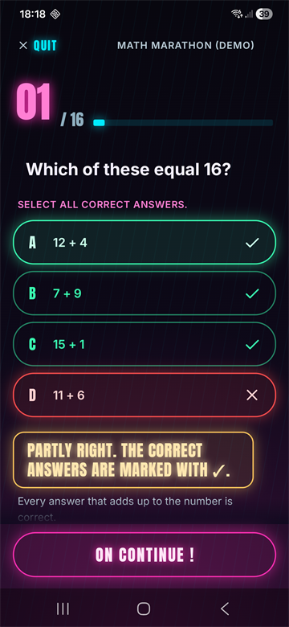
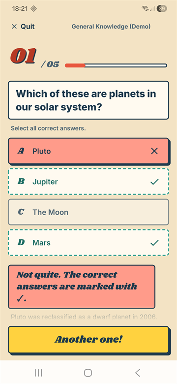
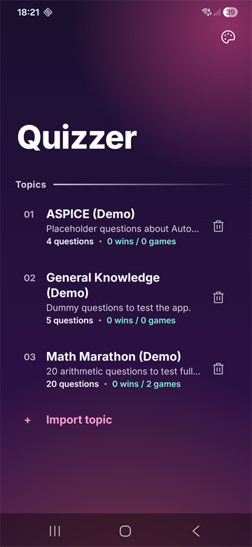

# Quizzer
How can I easily learn new things while commuting?

Quizzer is a simple Android quiz app (Kotlin + Jetpack Compose). Questions are not hardcoded:
each topic is a JSON file that can be imported into the app. Games of 16 questions, multiple
correct answers per question, a learning history that brings back what you got wrong, and
four selectable themes.

<table>
  <tr>
    <td align="center"></td>
    <td align="center"></td>
    <td align="center"></td>
  </tr>
  <tr>
    <td align="center"><sub>Topics · Sunset Coast</sub></td>
    <td align="center"><sub>Quiz · Neon Night</sub></td>
    <td align="center"><sub>Result · Neon Night</sub></td>
  </tr>
  <tr>
    <td align="center"></td>
    <td align="center"></td>
    <td align="center"></td>
  </tr>
  <tr>
    <td align="center"><sub>Quiz · Postcard</sub></td>
    <td align="center"><sub>Topics · Pocket Phone</sub></td>
    <td align="center"><sub>Theme picker</sub></td>
  </tr>
</table>

## Topic file format

One file per topic. Each question has 2–4 answers; one, several, or all of them can be correct.

```json
{
  "title": "ASPICE",
  "description": "Optional short description shown in the topic list.",
  "questions": [
    {
      "question": "Which of these are capability levels in ASPICE?",
      "answers": [
        { "text": "Level 0 – Incomplete", "correct": true },
        { "text": "Level 1 – Performed",  "correct": true },
        { "text": "Level 7 – Perfect",    "correct": false }
      ],
      "explanation": "Optional. Shown after the answer has been checked."
    }
  ]
}
```

| Field | Required | Notes |
|---|---|---|
| `title` | yes | Importing a file with the same title replaces the existing topic. |
| `description` | no | |
| `questions[].question` | yes | |
| `questions[].answers` | yes | 2–4 entries, at least one with `"correct": true`. |
| `answers[].correct` | no | Defaults to `false`. |
| `questions[].explanation` | no | |

### IDs

Files contain no IDs. The app generates a **topic ID** from the title's initials
(`"Android Automotive Knowledge"` → `aak`; one-word titles use the word, e.g. `aspice`) and
**question IDs** from the position in the file (`aak-0`, `aak-1`, …). The learning history is
stored per question ID, so **only append new questions at the end** of a file – inserting,
deleting or reordering shifts the IDs. Fixing the wording of a question is fine.

## Game rules

- A game has 16 questions, picked at random; questions answered wrong before come up more often.
  Topics with fewer questions give a short game with all of them.
- **Correct:** exactly the correct answers selected. **Partially correct:** at least one correct
  answer selected, but not exactly the right set. **Wrong:** no correct answer selected.
- You win with at least 75 % correct (rounded up: 12 of 16). Partially correct doesn't count.
- Answers are shuffled for every question. The buttons show random labels ("Fire!", "¡Vamos!", …),
  defined in `app/src/main/res/values/labels.xml`.

See `docs/PLAN.md` for the plan and what's still open.

## Topics in the app

- Three demo topics (`app/src/main/assets/topics/`) are installed on first launch.
- **Import topic** opens the system file picker; the file is validated and copied into the app.
- Topics can be deleted from the topic list; this also deletes their statistics.
- Wins / games per topic are shown in the topic list.
- `sample-topics/` contains an extra file for testing the import, e.g.:
  `adb push sample-topics/kotlin_basics_demo.json /sdcard/Download/`

## Themes

Tap the palette icon on the topic list to pick a theme. Four themes are built in
(`app/src/main/assets/themes/`); more can be imported as theme JSON files (schema v1, documented in
`docs/design/themes/sunset-coast/handoff.md`). A theme changes colors, fonts, shapes and backgrounds;
the layout stays the same.

## Build & run

```
.\gradlew installDebug     # build and install on the connected device
.\gradlew testDebugUnitTest  # run unit tests
```
